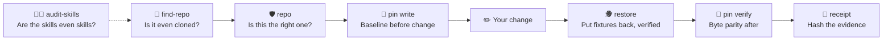

<div align="center">

# 🫡 CAPTAIN OBVIOUS

### The Claude Code skills that do the thing *before* announcing they will do the thing.

**Six real skills · One Python file · Zero imaginary test passes**

[](https://github.com/QSOLKCB/CLAUDE-SKILLS-CAPTAIN-OBVIOUS/actions/workflows/ci.yml)


[**🌐 Live site**](https://qsolkcb.github.io/CLAUDE-SKILLS-CAPTAIN-OBVIOUS/) · [**⚙️ Skills**](.claude/skills/) · [**🔍 The Python**](tools/obvious.py) · [**🧪 Tests**](tests/) · [**📜 Lab history**](#-laboratory-history)

</div>

> [!NOTE]
> **BREAKING:** An AI assistant has examined a repository and confirmed that it contains files. Further developments are anticipated.

<sub>*Independent parody. Not affiliated with Anthropic. The utilities are real; the bureaucracy is fictional.*</sub>

---

## 🚨 The problem nobody asked us to solve

You ask an AI agent to fix some code. It replies:

> *"I'll inspect the repository, review the relevant files, assess the test infrastructure, establish a baseline, and then proceed with a carefully considered implementation."*

You wait.

> *"I have inspected the repository and identified that the files are present."*

**Congratulations. Your task now has a press secretary.**

Captain Obvious started as a parody of that behaviour. Then, in a regrettable outbreak of engineering discipline, the joke acquired a real CLI, offline regression tests and six working Claude Code skills.

> [!IMPORTANT]
> **The punchline:** a status update is not evidence. A green badge is not proof. Reading a `SKILL.md` is not the same as Claude Code loading it.

## 🧰 The six skills

<table>
<tr>
<td width="33%" valign="top">

### 🛡️ 001
**[Wrong Repository Preflight](.claude/skills/wrong-repository-preflight/SKILL.md)**

Checks that the GitHub origin is the repository you actually meant.

<code>/wrong-repository-preflight</code>

*"I have confirmed the repo is the repo."*

</td>
<td width="33%" valign="top">

### 🧾 002
**[Receipts, Or It Didn't Happen](.claude/skills/receipts-or-it-didnt-happen/SKILL.md)**

SHA-256 receipts for real evidence files, stamped `RECORDED_NOT_VERIFIED`.

<code>/receipts-or-it-didnt-happen</code>

*"This file contains a number of bytes."*

</td>
<td width="33%" valign="top">

### 👻 003
**[No Ghosts in the Tick](.claude/skills/no-ghosts-in-the-tick/SKILL.md)**

Pins snapshot hashes before a refactor and verifies byte parity after it.

<code>/no-ghosts-in-the-tick</code>

*"The before is the same as the after."*

</td>
</tr>
<tr>
<td width="33%" valign="top">

### 🏺 004
**[Repository Archaeologist](.claude/skills/repository-archaeologist/SKILL.md)**

Finds a local checkout in authorised folders, offline, before anyone calls it "missing".

<code>/repository-archaeologist</code>

*"It is not in the places where it is not."*

</td>
<td width="33%" valign="top">

### 🕵️ 005
**[Alias of Betrayal](.claude/skills/alias-of-betrayal/SKILL.md)**

Restores fixtures with Python, not with whatever `cp` means today, and verifies the bytes.

<code>/alias-of-betrayal</code>

*"The shell asked if I was sure. Nobody answered."*

</td>
<td width="33%" valign="top">

### 🧑‍⚖️ 006
**[The Skill That Audits Skills](.claude/skills/skill-that-audits-skills/SKILL.md)**

Statically checks every `SKILL.md`. Executes nothing. Rejects "Be useful."

<code>/skill-that-audits-skills</code>

*"This Markdown file contains Markdown."*

</td>
</tr>
</table>

### How they fit together



## ⚡ Quick start

Clone the repository and start a **new** Claude Code session from its root:

```bash
git clone https://github.com/QSOLKCB/CLAUDE-SKILLS-CAPTAIN-OBVIOUS.git
cd CLAUDE-SKILLS-CAPTAIN-OBVIOUS
claude
```

Then confirm the skill files are well-formed. This needs no Claude, no network and no packages:

```bash
python3 tools/obvious.py audit-skills --root .
```

> [!TIP]
> The audit can only tell you a skill is `DISCOVERABLE_ON_DISK`. To claim `ACTUALLY_LOADED_BY_CLAUDE`, check that the skill appears in your Claude Code session, or invoke it as a slash command. Starting Claude in another directory and opening this one later is **not evidence**.

**To use these skills in another project:** review the six `.claude/skills/` directories and `tools/obvious.py`, then copy them to the same locations in that project. Check for existing files before replacing anything. The skill commands assume `tools/obvious.py` is reachable relative to the working directory.

**Requirements:** Python 3.10+ and Git. Claude Code is only needed if you want slash commands. There is no NPM, Docker, database, cloud API or `pip install`.

## 🏆 Enterprise-grade obviousness, consumer-grade price

| Marketing department says | Engineering department actually does |
| :--- | :--- |
| 🛡️ **Wrong-Repository Intelligence™** | Compares a checkout's GitHub origin with the expected `OWNER/REPO`, and can optionally reject a dirty worktree |
| 🧾 **Evidence-Driven Assurance Architecture™** | Hashes real evidence bytes with SHA-256 and labels the receipt `RECORDED_NOT_VERIFIED` |
| 👻 **Deterministic Reality Stabilisation™** | Pins and verifies snapshot-file hashes, and reports byte parity, **not** frame-rate correctness |
| 🏺 **Distributed Repository Recovery Platform™** | Walks only the folders you authorise, never follows symlinks and never clones |
| 🕵️ **Shell Integrity Counterintelligence Suite™** | Copies with Python's file operations, replaces atomically, re-hashes the result and ignores your aliases |
| 🧑‍⚖️ **Autonomous Skill Governance Engine™** | Applies a few regular expressions and an admirable amount of restraint |
| 📡 **Zero-Friction Neural Compliance Fabric™** | A single Python standard-library script. There is no neural fabric. |

## 📖 Skill catalogue

Every command prints JSON. The exit codes are deliberately boring:

| Exit | Meaning |
| :---: | :--- |
| `0` | Success: `PASS`, `MATCH`, `RECORDED…` or `RESTORED_AND_VERIFIED` |
| `1` | A negative finding, reported as JSON on stdout (`find-repo`, `audit-skills`) |
| `2` | Refusal or invalid input. A `FAIL:` line on stderr explains it, and nothing was changed |

<details>
<summary><strong>🛡️ 001 — Wrong Repository Preflight</strong></summary>

<br>

```bash
python3 tools/obvious.py repo --path . \
  --expected QSOLKCB/CLAUDE-SKILLS-CAPTAIN-OBVIOUS --require-clean
```

A mismatched origin, a non-GitHub origin or an unexpectedly dirty worktree exits nonzero. No remote is ever edited.

**Not a claim:** the correct origin does not authorise writes, deployments or merges.

</details>

<details>
<summary><strong>🧾 002 — Receipts, Or It Didn't Happen</strong></summary>

<br>

```bash
python3 tools/obvious.py receipt --claim "The README exists" --evidence README.md
```

Records the path, byte length and SHA-256 of each file. Missing files are rejected, as are symlinked path components and duplicate file identities, including hard links.

**Not a claim:** a hash shows which bytes you had, not that a test passed.

</details>

<details>
<summary><strong>👻 003 — No Ghosts in the Tick</strong></summary>

<br>

```bash
python3 tools/obvious.py pin write  --root . --manifest /tmp/pins.json README.md
python3 tools/obvious.py pin verify --root . --manifest /tmp/pins.json
```

The manifest is written atomically. Traversal, symlinks, duplicates and a manifest pinning itself are all refused. For game work, pin real state snapshots generated from fixed seeds, input tapes and tick counts.

**Not a claim:** identical bytes do not, on their own, establish 60 FPS or correct simulation semantics.

</details>

<details>
<summary><strong>🏺 004 — Repository Archaeologist</strong></summary>

<br>

```bash
python3 tools/obvious.py find-repo \
  --expected QSOLKCB/CLAUDE-SKILLS-CAPTAIN-OBVIOUS \
  --search ~/src --search /tmp --max-depth 4
```

| Status | Exit | Meaning |
| --- | :---: | --- |
| `MATCH` | 0 | Exactly one checkout has the expected GitHub origin |
| `AMBIGUOUS` | 1 | Several do. Ask which one is meant |
| `WRONG_REMOTE` | 1 | A similarly named checkout points elsewhere, such as a fork or no origin |
| `NOT_FOUND` | 1 | Probably never cloned. It prints a `git clone` command to run **only with approval** |

The search is bounded by depth and directory count. Overlapping roots keep their own depth allowance. Symlinks are listed, not followed, and `.git` is never entered. Credentials in origin URLs are redacted.

</details>

<details>
<summary><strong>🕵️ 005 — Alias of Betrayal</strong></summary>

<br>

```bash
python3 tools/obvious.py restore \
  --source /tmp/fixtures/original.snap \
  --dest   /tmp/fixtures/work/tick-0600.snap \
  --overwrite --expected-sha256 "$PRISTINE_SHA256"
```

- Replacing an existing file requires `--overwrite`.
- Self-copies are rejected, including `..` spellings and hard links. So are symlinks.
- An empty `--expected-sha256` is refused rather than silently skipped.
- The copy is written to a temporary file, fsynced, then swapped in with `os.replace`.
- The bytes read, the temporary copy and the final destination are all hashed.

A regression test replays the original incident with a real `bash` and `alias cp='cp -i'`.

> [!WARNING]
> Python cannot see aliases or functions defined in another shell. Inspect the shell that ran the command with `type cp`, `alias cp` or `command -V cp`. Bypass both aliases and functions with `command cp`; `\cp` bypasses aliases only.

</details>

<details>
<summary><strong>🧑‍⚖️ 006 — The Skill That Audits Skills</strong></summary>

<br>

```bash
python3 tools/obvious.py audit-skills --root .
```

**What it checks:**
- Frontmatter is present.
- `name` is valid and matches the directory.
- The `description` is real.
- The procedure has at least two numbered steps.
- There are no placeholders.
- Every referenced script exists inside the repository and is not reached through a symlink. Symlinks are checked *before* `..` is collapsed.
- Scripts invoked directly as `./<script>` need the execute bit. Interpreter arguments don't.

**What it doesn't do:**
- It is **not** a YAML parser. Unsupported syntax is reported as `UNSUPPORTED_FRONTMATTER`, not guessed at.
- It executes nothing, and `commands_executed` is always `0`.
- `actually_loaded_by_claude` is always `null`, because a file audit cannot observe it.

A fixture skill whose entire body is "Be useful." fails with `PLATITUDE_ONLY`.

</details>

## 🖥️ Live demonstration: the Department of Evidence

**[The Captain Obvious website](https://qsolkcb.github.io/CLAUDE-SKILLS-CAPTAIN-OBVIOUS/)** has a working SHA-256 receipt station built on browser Web Crypto. Files up to 16 MiB are hashed locally, with no upload and no analytics. It also has an executive status-update generator whose usefulness has not been independently established.

## 🧪 Quality assurance: verified, not narrated

```bash
python3 -B -m unittest discover -s tests -v
```

| Suite | Tests | Covers |
| --- | :---: | --- |
| `test_obvious.py` | 23 | Repo identity, receipts, pins, symlinked parents, hard links, copyable site commands |
| `test_repository_archaeologist.py` | 17 | All four statuses, depth limits, overlapping roots, symlinks, determinism |
| `test_alias_of_betrayal.py` | 18 | Overwrite authorisation, self-copy, symlinks, digests, the `cp -i` incident, `\cp` vs `command cp` |
| `test_skill_that_audits_skills.py` | 24 | Frontmatter, procedures, references, symlink traversal, a marker proving nothing executes |
| `test_site_six_skills.py` | 3 | The site and README feature all six skills |

That makes **85 offline tests at v0.3.0**. For the *current* result, check the [Actions run history](https://github.com/QSOLKCB/CLAUDE-SKILLS-CAPTAIN-OBVIOUS/actions/workflows/ci.yml). Historical green is not current green.

> [!CAUTION]
> The filesystem checks are practical guards, **not** proof of immunity to adversarial concurrent changes (TOCTOU).

## 📜 Laboratory history

| Experiment | What happened | Outcome |
| --- | --- | --- |
| **CO-LIVE-001** | Claude couldn't find the repo, because it had never been cloned. Once cloned, it followed the skills by hand, since they were never *loaded*. Its `cp` restore failed because `cp` was aliased to `cp -i`. It also found three real filesystem-identity defects. | Fixed in [PR #3](https://github.com/QSOLKCB/CLAUDE-SKILLS-CAPTAIN-OBVIOUS/pull/3) |
| **CO-LIVE-002** | Each harness embarrassment from CO-LIVE-001 became a skill: 004 for the uncloned repo, 005 for the alias, 006 for the not-loaded skills. Tests were written before the code. | [PR #5](https://github.com/QSOLKCB/CLAUDE-SKILLS-CAPTAIN-OBVIOUS/pull/5), v0.3.0 |
| **Review round** | An automated reviewer found five more issues: overlapping search roots, the execute bit, an empty digest, a symlink hidden before `..`, and `\cp` vs functions. | Reproduced, then fixed, in PR #5 |

> **Captain's official finding:** *"We built a skill to check whether our skills are skills. It has confirmed that they are files."*

## 🗂️ Architecture: the smallest possible bureaucracy

```text
CLAUDE-SKILLS-CAPTAIN-OBVIOUS/
├── .claude/skills/
│   ├── wrong-repository-preflight/SKILL.md
│   ├── receipts-or-it-didnt-happen/SKILL.md
│   ├── no-ghosts-in-the-tick/SKILL.md
│   ├── repository-archaeologist/SKILL.md
│   ├── alias-of-betrayal/SKILL.md
│   └── skill-that-audits-skills/SKILL.md
├── tools/obvious.py         # The entire CLI: Python standard library only
├── tests/                   # Offline unittest suites, one per concern
├── index.html               # Static site with browser Web Crypto
└── .github/workflows/       # CI on PRs and main; Pages from main only
```

No database. No microservices. No Kubernetes. The project's largest infrastructural dependency is the operator remembering which directory they are in.

## ❓ Frequently announced questions

<details>
<summary><strong>Is this an actual Claude Code skill project or just a joke?</strong></summary>

<br>Both. The skills are discoverable <code>SKILL.md</code> files that drive a real, tested CLI. The jokes are commentary. The checks are executable code.

</details>

<details>
<summary><strong>How do I know Claude actually loaded the skills?</strong></summary>

<br>Start Claude Code at the repository root, then check that the skills are listed or invoke one as a slash command. <code>audit-skills</code> only establishes <code>DISCOVERABLE_ON_DISK</code>, and it says so.

</details>

<details>
<summary><strong>Does a SHA-256 receipt prove my tests passed?</strong></summary>

<br>No. It identifies the bytes you supplied. You still need the command, the exit status, the environment and the tested commit.

</details>

<details>
<summary><strong>Will it clone the repository for me if it's missing?</strong></summary>

<br>No. <code>find-repo</code> prints the clone command and stops. Contacting GitHub is a decision for the operator.

</details>

<details>
<summary><strong>Can I let Captain Obvious merge my pull requests?</strong></summary>

<br>Not on the basis of an identity check. Knowing which repository is open is not permission to deploy it.

</details>

---

<div align="center">

### 🫡 THE CAPTAIN'S FINAL STATUS UPDATE

**"The README has been made awesome. Its awesomeness has been documented in the README."**

[**Open the live site**](https://qsolkcb.github.io/CLAUDE-SKILLS-CAPTAIN-OBVIOUS/) · [**Inspect the source**](https://github.com/QSOLKCB/CLAUDE-SKILLS-CAPTAIN-OBVIOUS) · [**View the license**](LICENSE)

<sub>Apache-2.0 · Independent satire · Not affiliated with Anthropic · No claims of 110% test coverage were harmed in the making of this README.</sub>

</div>
